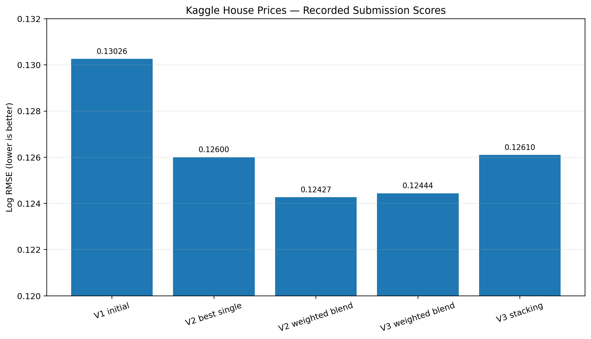
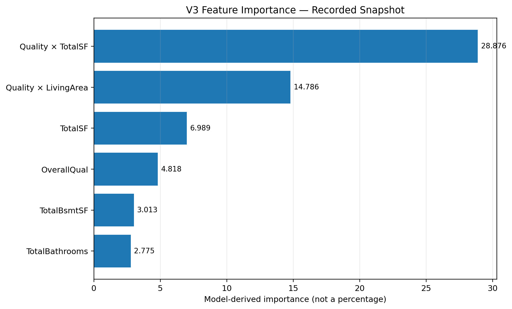

# 🏡 House Price Prediction — Advanced Regression & Ensemble Learning

An end-to-end Machine Learning project for predicting residential house prices using advanced regression algorithms, feature engineering, hyperparameter optimization, and ensemble learning.

Built for the **House Prices – Advanced Regression Techniques** competition on Kaggle.

<p align="center">
  
</p>

## 🏆 Best Kaggle Performance

| Metric | Result |
|---|---|
| Best Kaggle RMSE | **0.12427** |
| Best Version | V2 |
| Best Approach | Weighted Blending |
| Competition | House Prices - Advanced Regression Techniques |
| Platform | Kaggle |

Lower RMSE indicates better performance.

## 📌 Project Overview

The objective is to predict the final sale prices of residential houses in Ames, Iowa, using 79 explanatory variables describing different aspects of residential properties.

The project was developed through three iterations:

- **V1:** Baseline regression models and model comparison.
- **V2:** Advanced boosting algorithms, hyperparameter optimization, and weighted blending.
- **V3:** Advanced feature engineering, outlier analysis, weighted blending, and stacking.

## 🎯 Project Objectives

- Perform Exploratory Data Analysis (EDA).
- Handle missing values and categorical variables.
- Develop meaningful features from existing housing attributes.
- Implement multiple regression algorithms.
- Compare model performance using cross-validation.
- Optimize hyperparameters using Optuna.
- Experiment with weighted blending and stacking.
- Generate predictions for Kaggle submissions.

## 🛠️ Technologies Used

| Category | Technologies |
|---|---|
| Programming | Python |
| Data Processing | Pandas, NumPy |
| Visualization | Matplotlib, Seaborn |
| Machine Learning | Scikit-learn |
| Boosting | XGBoost, LightGBM, CatBoost |
| Optimization | Optuna |
| Development | Jupyter Notebook, VS Code |
| Version Control | Git, GitHub |

## 🤖 Machine Learning Models

### Traditional Regression
- Ridge Regression
- Lasso Regression
- ElasticNet
- Random Forest
- Extra Trees
- Gradient Boosting

### Advanced Boosting
- XGBoost
- LightGBM
- CatBoost

### Ensemble Learning
- Weighted Blending
- Stacking Regressor

## 📊 Kaggle Submission Results

The project was developed and evaluated through multiple submissions.

| Version | Model | Kaggle RMSE |
|---|---|---:|
| V1 | Initial Submission | 0.13026 |
| V2 | Best Single Model | 0.12600 |
| V2 | Weighted Blending | **0.12427** |
| V3 | Weighted Blending | 0.12444 |
| V3 | Stacking | 0.12610 |

**Best Result: 0.12427 RMSE — V2 Weighted Blending.**

### Performance Visualization

<p align="center">
  
</p>

## 🔍 Feature Engineering

Several additional features were developed to capture meaningful relationships between house characteristics.

Examples include:

- Total House Area
- Total Bathrooms
- House Age
- Remodel Age
- Total Porch Area
- Garage Availability
- Basement Availability
- Pool Availability
- Quality × Living Area
- Quality × Total Square Footage

### Feature Importance

<p align="center">
  
</p>

The importance scores represent model-derived feature importance, not causal effects.

## 📚 Project Documentation

Detailed documentation is available in the `docs/` directory.

| Document | Description |
|---|---|
| [Project Report](docs/PROJECT_REPORT.md) | Complete project report and implementation overview |
| [Methodology](docs/METHODOLOGY.md) | Machine learning workflow, preprocessing, and algorithms |
| [Results & Analysis](docs/RESULTS_AND_ANALYSIS.md) | Model comparisons and Kaggle performance |
| [Future Scope](docs/FUTURE_SCOPE.md) | Potential improvements and future development |

## 📁 Project Structure

```text
house-price-prediction-ml/
│
├── data/                         # Local Kaggle datasets (not tracked)
│
├── notebooks/
│   └── house_prices_walkthrough.ipynb
│
├── src/
│   ├── train.py                  # V1 implementation
│   ├── train_v2.py               # V2 implementation
│   └── train_v3.py               # V3 implementation
│
├── results/
│   ├── best_submission_v2_blend.csv
│   ├── blend_weights_v3.csv
│   ├── feature_importance_v3.csv
│   ├── model_comparison_v2.csv
│   ├── model_comparison_v3.csv
│   └── outlier_review_v3.csv
│
├── visualizations/
│   ├── kaggle_submission_scores.png
│   └── feature_importance_v3.png
│
├── docs/
│   ├── PROJECT_REPORT.md
│   ├── METHODOLOGY.md
│   ├── RESULTS_AND_ANALYSIS.md
│   └── FUTURE_SCOPE.md
│
├── outputs/                      # Generated model outputs
│
├── .gitignore
├── README.md
├── requirements.txt
└── requirements_v2.txt
```

## ⚙️ Installation and Setup

### 1. Clone the Repository

```bash
git clone https://github.com/Prince08012007/house-price-prediction-ml.git
```

### 2. Navigate to the Project

```bash
cd house-price-prediction-ml
```

### 3. Create a Virtual Environment

```bash
python -m venv .venv
```

Activate on Windows:

```powershell
.venv\Scripts\activate
```

### 4. Install Dependencies

Install baseline requirements:

```bash
python -m pip install -r requirements.txt
```

Install advanced model requirements:

```bash
python -m pip install -r requirements_v2.txt
```

### 5. Download the Dataset

Download the following files from Kaggle:

- `train.csv`
- `test.csv`

Place both files inside the local `data/` folder.

Dataset:

https://www.kaggle.com/competitions/house-prices-advanced-regression-techniques/data

### 6. Run the Models

Baseline implementation:

```bash
python src/train.py
```

Advanced implementation:

```bash
python src/train_v2.py
```

Advanced feature engineering and ensemble implementation:

```bash
python src/train_v3.py
```

Optional Optuna tuning for V2:

```bash
python src/train_v2.py --tune --trials 20
```

Check the individual scripts for their exact arguments and generated output locations.

## 📈 Evaluation Metric

The competition uses Root Mean Squared Error (RMSE) between the logarithms of predicted and actual house prices.

A lower score indicates better prediction performance.

## 💡 Key Learnings

- Practical implementation of regression algorithms.
- Feature engineering for structured datasets.
- Handling missing data and categorical variables.
- Cross-validation and model evaluation.
- Hyperparameter optimization using Optuna.
- Ensemble learning through blending and stacking.
- Understanding overfitting and generalization.
- Preparing and submitting Kaggle prediction files.

## 🔗 Project Links

- **GitHub Repository:** https://github.com/Prince08012007/house-price-prediction-ml
- **Kaggle Competition:** https://www.kaggle.com/competitions/house-prices-advanced-regression-techniques

## 👨‍💻 Author

**Prince**

Machine Learning | Artificial Intelligence | Python | Data Science

---

⭐ If you find this project useful or interesting, consider giving the repository a star!